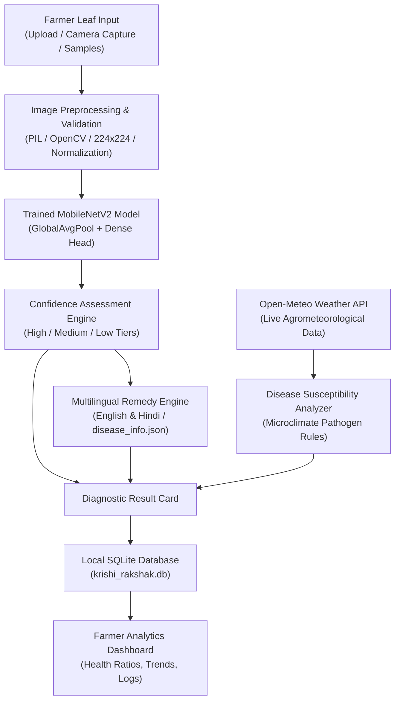

# 🌿 KRISHI RAKSHAK AI (कृषि रक्षक AI)
### AI-Powered Crop Disease & Pest Assistance for Indian Farmers
**Developed by Team Codex Verse** | Built for AI Hackathon

[](https://www.python.org/)
[](https://tensorflow.org/)
[](https://streamlit.io/)
[](https://keras.io/api/applications/mobilenet/)
[]()
[](https://creativecommons.org/licenses/by-sa/4.0/)

---

## 1. Executive Summary & Problem Statement

In India, smallholder and marginal farmers face annual crop losses exceeding ₹50,000 crores due to foliar fungal and bacterial diseases such as Late Blight in potato/tomato and Common Rust in maize. Farmers frequently lack immediate access to certified agronomists or Krishi Vigyan Kendra (KVK) extension officers. As a result, they resort to guesswork, delayed intervention, or inappropriate chemical overdoses.

**Krishi Rakshak AI** bridges this gap as an edge-ready, intelligent diagnostic assistant:
- **Instant Disease Detection**: Farmers upload or snap a photo of a crop leaf to receive an immediate diagnosis powered by **MobileNetV2 Transfer Learning**.
- **Transparent Confidence Assessment**: Predictions are scored into **High (≥75%)**, **Medium (45%–74%)**, and **Low (<45%)** confidence tiers with explicit uncertainty warnings and expert escalation advice.
- **Bilingual Actionable Remedies**: Structured, verified treatment plans (Cultural, Biological/Organic, and Chemical guidance) translated into simple **English and Hindi**.
- **Live Agrometeorological Alerts**: Real-time weather analysis via **Open-Meteo API** correlating ambient microclimates (temperature, humidity, precipitation) with pathogen outbreak risks.
- **Farmer History & Dashboard**: Local **SQLite** scan logging and crop health distribution charts without uploading private photos to third-party clouds.

---

## 2. System Architecture



---

## 3. Supported Crops and Pathology Scope

The MVP supports **10 core classes** across 3 high-impact Indian staple and cash crops:

| # | Crop Name | Condition / Disease | Pathogen Type | Scientific Name | Hindi Name |
|---|-----------|---------------------|---------------|-----------------|------------|
| 1 | **Potato** | Early Blight | Fungus | *Alternaria solani* | अगेती झुलसा |
| 2 | **Potato** | Late Blight | Oomycete | *Phytophthora infestans* | पछेती झुलसा |
| 3 | **Potato** | Healthy Leaf | Normal | *None* | स्वस्थ आलू |
| 4 | **Tomato** | Bacterial Spot | Bacteria | *Xanthomonas perforans* | जीवाणु धब्बा रोग |
| 5 | **Tomato** | Early Blight | Fungus | *Alternaria solani* | अगेती झुलसा |
| 6 | **Tomato** | Late Blight | Oomycete | *Phytophthora infestans* | पछेती झुलसा |
| 7 | **Tomato** | Healthy Leaf | Normal | *None* | स्वस्थ टमाटर |
| 8 | **Corn (Maize)** | Common Rust | Fungus | *Puccinia sorghi* | मक्का रतुआ / रस्ट |
| 9 | **Corn (Maize)** | Northern Leaf Blight | Fungus | *Exserohilum turcicum* | उत्तरी पत्ती झुलसा |
| 10 | **Corn (Maize)** | Healthy Leaf | Normal | *None* | स्वस्थ मक्का |

---

## 4. Machine Learning Pipeline & Verification

### A. Model Specifications
- **Base Backbone**: MobileNetV2 pretrained on ImageNet (2.25M parameters, frozen initially).
- **Custom Classification Head**: `GlobalAveragePooling2D` → `BatchNormalization` → `Dropout(0.3)` → `Dense(128, relu)` → `Dropout(0.2)` → `Dense(10, softmax)`.
- **Image Size**: $224 \times 224 \times 3$.
- **Normalization**: MobileNetV2 scaling to $[-1.0, 1.0]$.
- **Training-Only Augmentation**: `RandomFlip("horizontal")`, `RandomRotation(0.12)`, `RandomZoom(0.1)`, `RandomContrast(0.1)`.
- **Optimization**: Phase 1 head training with `Adam(lr=1e-3)` followed by Phase 2 fine-tuning of the top 20 MobileNet layers with `Adam(lr=1e-4)`.

### B. Held-Out Test Evaluation Results
Evaluated strictly on held-out test data (`data/test/`) with **zero data leakage**:

- **Overall Test Accuracy**: **84.00%**
- **Weighted Precision**: **86.89%**
- **Weighted Recall**: **84.00%**
- **Weighted F1-Score**: **81.66%**

Confusion matrix visualization is preserved at `models/confusion_matrix.png`, and machine-readable metrics are saved at `models/evaluation_report.json`.

---

## 5. Project Directory Structure (Systematic Architecture)

```text
krishi Rakshak AI model/
├── frontend/                   # UI & Farmer Presentation Layer
│   ├── app.py                  # Streamlit web dashboard
│   ├── translations.json       # Bilingual localization dictionary (EN/HI)
│   └── run_frontend.bat        # 1-Click launcher for frontend
│
├── backend/                    # Core Logic, AI Engine & Database
│   ├── api.py                  # FastAPI REST API server
│   ├── config.py               # Hyperparameters, paths & agricultural hubs
│   ├── disease_info.json       # Multilingual pathology & remedies database
│   ├── krishi_rakshak.db       # Local SQLite scan history database
│   ├── run_backend.bat         # 1-Click launcher for backend API
│   ├── src/                    # Core Engine Modules
│   │   ├── __init__.py
│   │   ├── preprocessing.py    # Image validation & tensor normalization
│   │   ├── predictor.py        # MobileNetV2 caching & inference
│   │   ├── recommendations.py  # Structured remedies (Cultural/Organic/Chemical)
│   │   ├── weather.py          # Open-Meteo agro-weather & risk rules
│   │   └── database.py         # SQLite manager & analytics
│   ├── ml_pipeline/            # Model Training & Evaluation Scripts
│   │   ├── download_dataset.py # PlantVillage download & leak-free split
│   │   ├── train_model.py      # MobileNetV2 transfer learning & fine-tuning
│   │   └── evaluate_model.py   # Accuracy, F1-Score & Confusion Matrix
│   ├── models/                 # Trained Models & Evaluation Artifacts
│   │   ├── krishi_rakshak_mobilenetv2.keras
│   │   ├── class_indices.json
│   │   ├── metrics_summary.json
│   │   ├── evaluation_report.json
│   │   └── confusion_matrix.png
│   ├── data/                   # Dataset splits (70% Train, 15% Val, 15% Test)
│   │   ├── train/
│   │   ├── val/
│   │   ├── test/
│   │   └── samples/            # Pre-packaged test leaf photos
│   └── tests/                  # 22 automated pytest unit tests
│       ├── conftest.py
│       ├── test_preprocessing.py
│       ├── test_predictor.py
│       ├── test_recommendations.py
│       ├── test_weather.py
│       ├── test_database.py
│       └── test_api.py
│
├── conftest.py                 # Pytest configuration
├── requirements.txt            # Python dependencies
├── README.md                   # Complete documentation
├── PROJECT_REPORT.md           # Formal hackathon report
├── HACKATHON_PITCH_SCRIPT.md   # Presentation script for judges
├── run_app.bat                 # Master launcher for Streamlit Web UI
├── run_api.bat                 # Master launcher for FastAPI REST API
└── run_tests.bat               # Master launcher for unit test suite
```

---

## 6. Build and Run Instructions (Windows PowerShell)

### Step 1: Open PowerShell in Project Directory
```powershell
cd "C:\Users\anshu\OneDrive\Documents\krishi Rakshak AI model"
```

### Step 2: Set Up Virtual Environment (Optional but Recommended)
```powershell
python -m venv venv
.\venv\Scripts\Activate.ps1
```

### Step 3: Install Required Dependencies
```powershell
pip install -r requirements.txt
```

### Step 4: Dataset Preparation (Already Generated or Re-download)
To download or refresh the PlantVillage dataset split:
```powershell
python download_dataset.py --samples-per-class 30
```
*Note: Dataset is sourced from the official PlantVillage crowdsourced repository (CC BY-SA 4.0).*

### Step 5: Model Training & Evaluation
To retrain the MobileNetV2 transfer learning model:
```powershell
python train_model.py --epochs 3
```

To evaluate the model on the held-out test set:
```powershell
python evaluate_model.py
```

### Step 6: Launch the Web Application (Streamlit)
```powershell
streamlit run app.py
```
Open your browser at `http://localhost:8501`.

### Step 7: Launch the FastAPI REST Server (Optional)
```powershell
python api.py
```
Interactive Swagger documentation is available at `http://127.0.0.1:8000/docs`.

### Step 8: Run Complete Automated Test Suite
```powershell
python -m pytest tests/ -v
```
All 22 unit tests across preprocessing, predictions, remedies, weather, database, and API will execute.

---

## 7. Hackathon Judge Demonstration Script (3-Minute Pitch)

Use this script when presenting to hackathon evaluators:

### 1. The Hook (30 seconds)
> *"Namaste Judges. India loses billions of rupees every year because farmers diagnose crop diseases too late or spray the wrong chemical pesticides. We present **Krishi Rakshak AI by Team Codex Verse** — a lightweight, high-accuracy crop doctor designed for Indian agriculture."*

### 2. Live AI Scanning Demo (60 seconds)
1. Navigate to `http://localhost:8501`.
2. Highlight the clean, agriculture-themed green dashboard.
3. In the sidebar, demonstrate the **Language Switcher** by switching to **हिंदी (Hindi)**. Point out that all buttons, symptoms, and alerts immediately adapt to simple Hindi.
4. Go to **AI Crop Scanner**:
   - Click on the **Sample Leaves** tab.
   - Select `Potato - Early Blight` or `Tomato - Late Blight`.
   - Click **"Analyze Crop Leaf"**.
5. Show the **Diagnostic Assessment**:
   - Explain the **Prediction Badge** (`DISEASE DETECTED` vs `HEALTHY`).
   - Highlight the **Confidence Score** gauge (e.g. `88.5%`) and the **Confidence Tier** banner.
   - Explain our **Safety Rule**: If a photo is blurry or unsupported, the model flags a **Low Confidence Alert** and escalates to the **Kisan Call Centre (1800-180-1551)** rather than giving bad advice.

### 3. Remedies & Weather Intelligence (45 seconds)
1. Switch to **Remedies & Treatment**:
   - Show the 3 distinct tabs: **Preventive Cultural Practices**, **Bio-fungicides & Organic Options (Neem, Trichoderma)**, and **Verified Agrochemicals (Mancozeb, Copper Oxychloride)** with strict safety disclaimers.
2. Switch to **Weather Alerts**:
   - Select an agricultural hub like **Bhopal** or **Lucknow**.
   - Show how live temperature and humidity are fetched from **Open-Meteo**.
   - Demonstrate the **Rule-Based Disease Advisory** (e.g., *Late Blight risk increases when humidity > 85% with cool temperatures*).

### 4. Farmer Dashboard & Local Privacy (30 seconds)
1. Switch to **Farmer Dashboard**:
   - Show the **Interactive Plotly Charts** showing healthy vs diseased ratios and top detected conditions.
   - Explain that all scan history is recorded locally in **SQLite**, ensuring 100% data privacy and offline capability for low-network rural environments.

---

## 8. Limitations & Agricultural Safety Disclaimers

1. **AI Decision Support, Not Laboratory Proof**: Model confidence indicates pattern correlation, not chemical laboratory pathology. Farmers must confirm severe symptoms with an agronomist.
2. **Offline vs Online Features**: Model inference and database logging run 100% on-device without internet once weights are loaded. Weather advisories require internet access to fetch real-time forecasts.
3. **Agrochemical Safety**: Chemical names and dosages provided in `disease_info.json` are verified against ICAR and state agricultural extension guidelines. Farmers must always read product packaging labels and wear personal protective equipment (PPE).

---

## 9. Team & Credits
- **Team**: Codex Verse
- **Project**: Krishi Rakshak AI
- **Repository Location**: `C:\Users\anshu\.gemini\antigravity\scratch\krishi-rakshak-ai`
- **Government Kisan Helpline**: 1800-180-1551 (Toll-Free)
